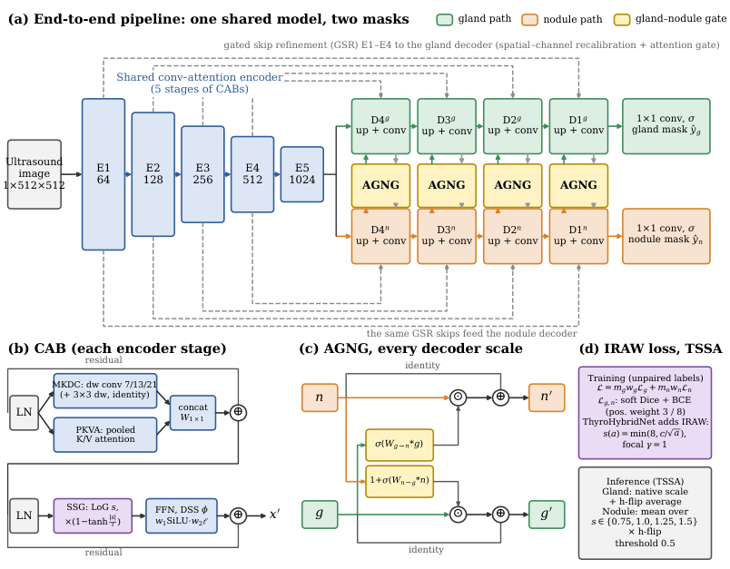
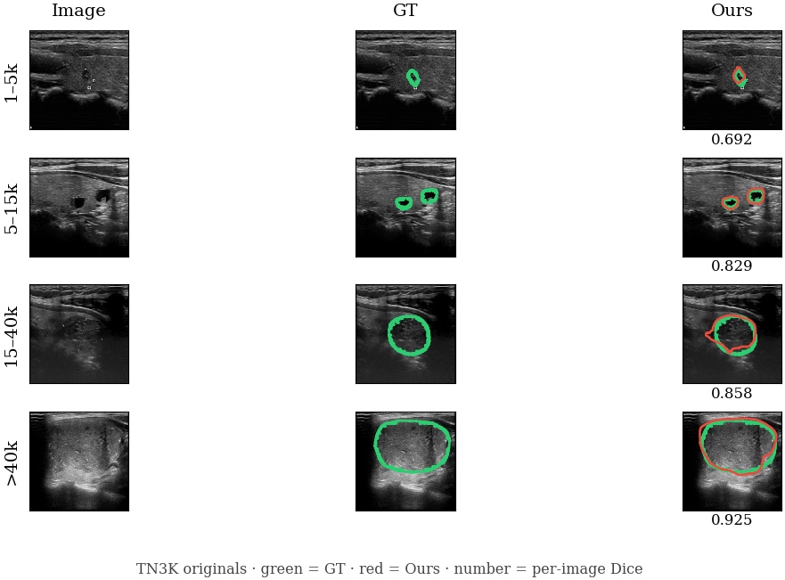
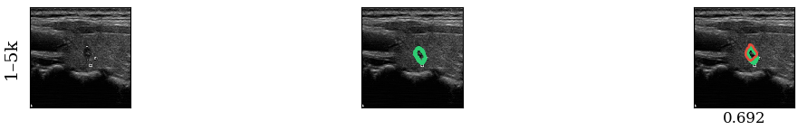
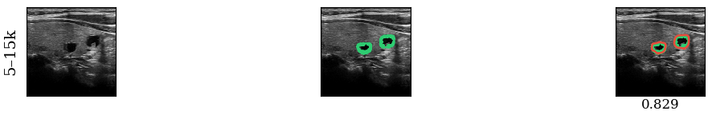
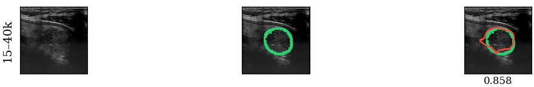
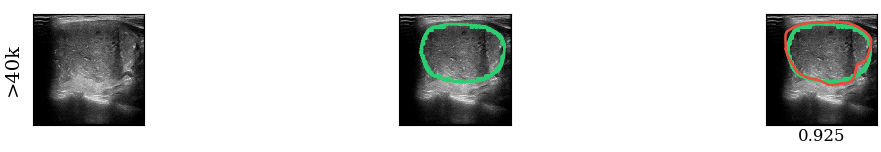
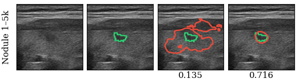
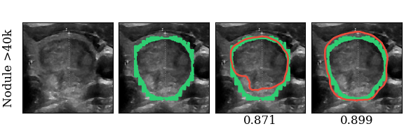
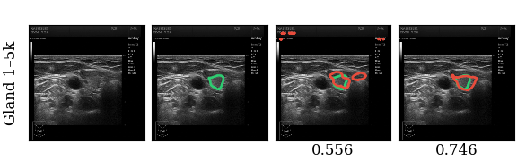
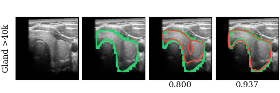

<div align="center">

# ThyroHybridNet

**Scale-Aware Joint Segmentation of the Thyroid Gland and Nodules in Ultrasound**

CVPR 2027 submission

Official code for the inference recipe, with the architecture and the qualitative results from the paper.

</div>

One shared encoder predicts the gland and the nodule together. At every decoder scale the gland multiplicatively gates the nodule, and the nodule can only boost the gland. Small nodules receive a larger training weight, and nodule inference averages four scales.

## Architecture

<div align="center">

</div>

Shared five-stage convolution–attention encoder, dual decoders, and Asymmetric Gland–Nodule Guidance (AGNG) after every upsampling stage. Gated skip refinement feeds both heads.

## Qualitative results

Green is the reference mask. Red is the prediction. The number under a frame is that frame's Dice.

<div align="center">

<br>
<i>TN3K nodules across area bins.</i>
</div>

<p align="center">


<br>


</p>

<div align="center">

<br>
<i>TN3K 1–5k bin, Base setting, Dice below 0.5: 14 over-segmentation, 8 boundary mismatch, 1 miss.</i>
</div>

<div align="center">

<br>
<i>Hospital cohort. Public is the public checkpoint on the same frame. Ours is the hospital-trained model.</i>
</div>

<p align="center">


<br>


</p>

<div align="center">

<br>
<i>TN3K nodules and hospital gland frames by area bin.</i>
</div>

## Quantitative results

Dice is the mean of per-image scores at threshold 0.5 and resolution 512×512. Published scores for the other joint models are quoted from those papers and were not re-run. Resolution, split, and aggregation differ, so those numbers are context rather than a controlled ranking. SSMT-Net's gland number is an auxiliary ablation, not an official TG3K test.

| Method | TN3K | TG3K gland | DDTI |
| --- | ---: | ---: | ---: |
| TRFE+ | 0.833 | — | 0.690 |
| SSMT-Net | 0.869 | 0.952 | 0.692 |
| DualSwinUnet++ | 0.812 | — | — |
| **ThyroHybridNet** | **0.872** | **0.989** | **0.722** |

<div align="center">

<br>
<i>TN3K Dice rises with nodule area. The official mean, 0.872, is the count-weighted average of these bins.</i>
</div>

| TN3K area bin | Images | Full configuration |
| --- | ---: | ---: |
| <1k | 10 | 0.642 |
| 1–5k | 141 | 0.784 |
| 5–15k | 161 | 0.876 |
| 15–40k | 155 | 0.893 |
| >40k | 147 | 0.931 |
| All | 614 | **0.872** |

Hospital evaluation uses an image-level 10% hold-out, seed 42: 572 gland images and 395 nodule images. The split is not patient-level.

| Setting | Gland | Nodule |
| --- | ---: | ---: |
| Public checkpoint on this split | 0.756 | 0.704 |
| Hospital cohort | **0.887** | **0.807** |

## Code

`code/published.py` is the published inference recipe: AGNG, inverse-root area weighting, four-scale flip averaging, and the 15×15 soft gland gate. Training code is not included.

```bash
pip install torch
```

```python
import torch
from published import AGNG, iraw_weight, tssa, soft_gland_gate

gland, nodule = AGNG(channels=64)(gland_feat, nodule_feat)
weight = iraw_weight(area_px)          # smaller masks, larger weight, cap 8
nodule_prob = tssa(predict_prob, image)  # scales 0.75, 1.0, 1.25, 1.5
nodule_prob = soft_gland_gate(nodule_prob, gland_prob)
```

Run the snippet from the `code/` directory. Nodule maps are thresholded at 0.5. The gland uses the native scale and a horizontal flip. The headline TN3K result also applies the soft gland gate.

## Citation

```bibtex
@inproceedings{thyrohybridnet2027,
  title     = {ThyroHybridNet: Scale-Aware Joint Segmentation of the Thyroid Gland and Nodules in Ultrasound},
  author    = {Anonymous},
  booktitle = {Proceedings of the IEEE/CVF Conference on Computer Vision and Pattern Recognition},
  year      = {2027}
}
```
