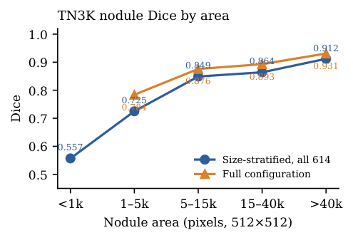
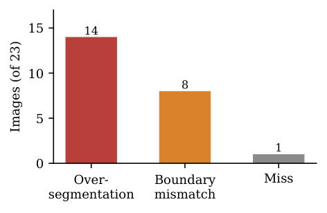
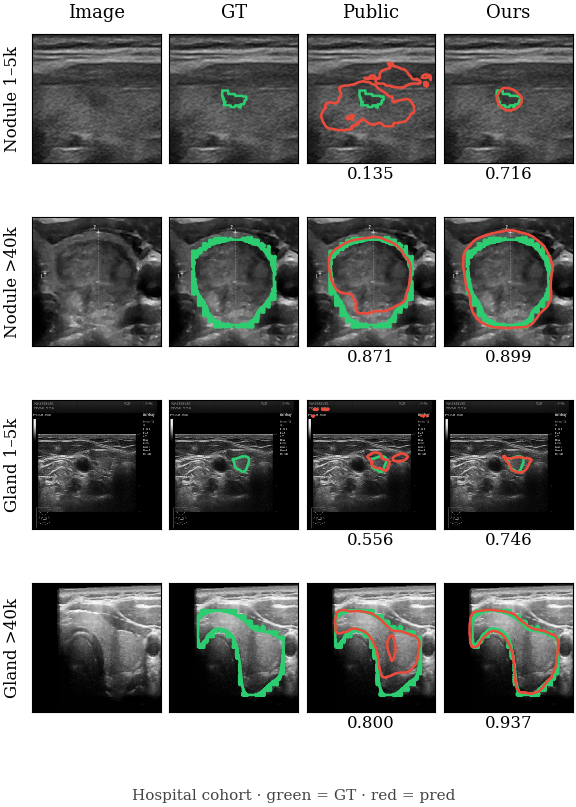
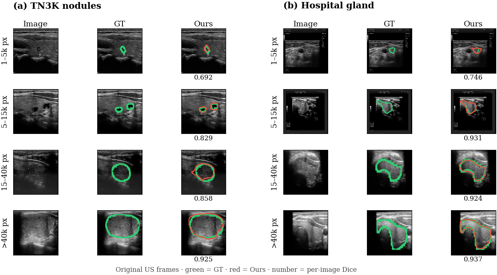

# ThyroHybridNet

One network predicts the thyroid gland and the nodule. The gland multiplicatively gates the nodule at every decoder scale. The nodule can only boost the gland. Small nodules are up-weighted in training, and nodule inference averages four scales.

Reported mean Dice is TN3K 0.872, TG3K gland 0.989, DDTI 0.722, and hospital gland 0.887 / nodule 0.807. A number printed on a frame is that frame's Dice. Green is the reference. Red is the prediction.

## TN3K nodules

## Hospital cohort

The left prediction is the public checkpoint on the same frame. The right prediction is the hospital-trained model.

## Gland and nodule together

## Network

`code/published.py` is the published inference recipe: asymmetric guidance, inverse-root area weights, four-scale flip averaging, and the 15×15 soft gland gate. Training code is not included.
